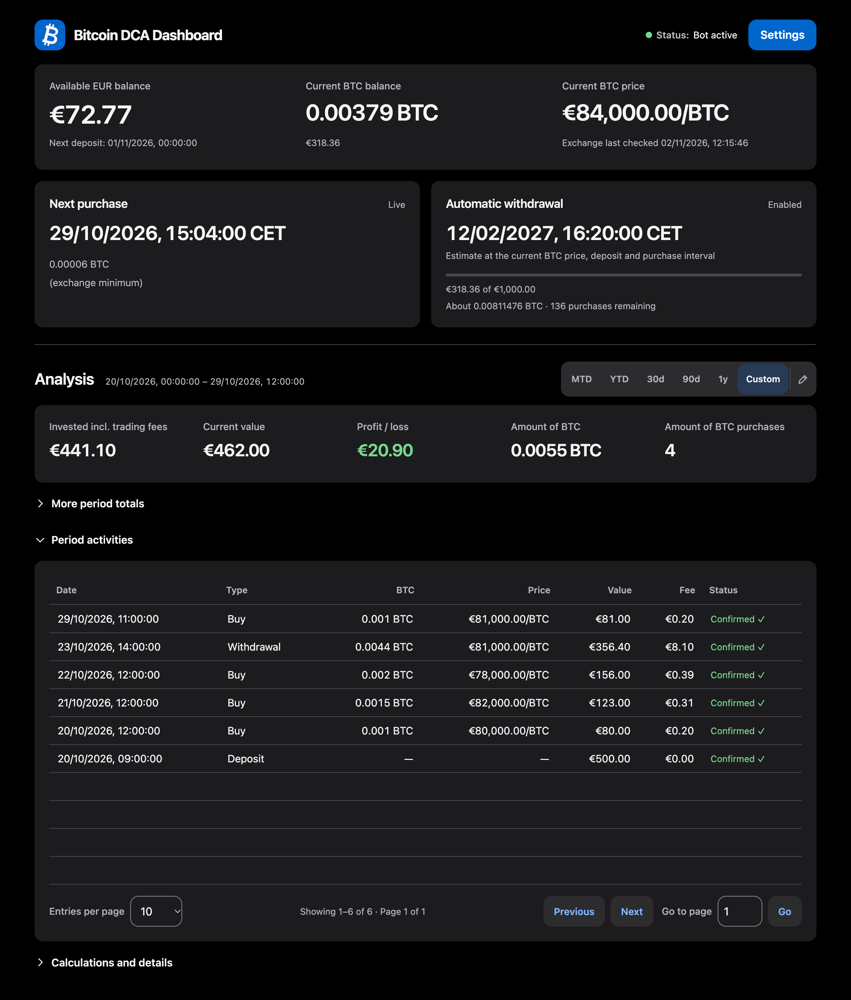

# Bitcoin DCA Bot

A Docker bot for Bitcoin purchases on Kraken or Bitvavo, with optional automatic and manual withdrawals. It spreads purchases across the time until your next monthly deposit. The responsive dashboard supports English and German.

<details>
<summary>Dashboard preview</summary>



</details>

## Setup

Requires Docker Compose, internet access and an exchange account. Run one bot per exchange account.

```sh
git clone https://github.com/oli792dev/docker-bitcoin-dca.git
cd docker-bitcoin-dca
cp .env.example .env
```

1. Set `WEB_UI_TLS_HOSTS` in `.env` to the Docker host IP or hostname you will use. Separate multiple addresses with commas.
2. Run `docker compose up -d --build`.
3. Open `https://<docker-host>:6890` and [trust the local certificate authority](docs/architecture.md#https-and-session-security).
4. Create login credentials (password: at least 12 characters), then configure the exchange and bot in the setup wizard.

Grant these API permissions:

| Exchange | Read access | Live purchases | Optional withdrawals |
| --- | --- | --- | --- |
| Kraken | Query Funds; Query Open/Closed Orders & Trades; Query ledger entries | Modify Orders | Withdraw Funds |
| Bitvavo | Read-only / View | Trade digital assets | Withdraw digital assets |

Test connection reports funds, orders, history, trade and withdrawal access separately as proven, denied or unknown. It uses only reads; Kraken key metadata can confirm write scopes, while Bitvavo write scopes remain unknown. Enter credentials only in the web settings; never commit credentials or `.env`.

## Usage

- Settings controls the exchange, purchase amount, deposit day/time, timezone and dashboard preferences. New installations use Simulation; enable live trading to place real orders. Amounts below the exchange minimum, including `0`, use that minimum.
- Account checks normally run every five minutes. Purchases use the available fiat budget, estimated fees and time from the last purchase to the next deposit. The final purchase uses remaining funds where exchange limits allow.
- Deposits are verified through the exchange API. Early confirmed deposits advance planning; delayed or unverified funding can pause purchases. The bot does not transfer monthly deposits itself.
- Automatic withdrawals use all available exchange BTC, including BTC acquired outside the bot. Set a threshold and target: a saved withdrawal-method label for Kraken, or a verified address/network for Bitvavo.
- Manual withdrawal and Parqet export are in the Settings footer. Withdrawals require live trading and send available BTC minus fees; manual withdrawals require confirmation and bypass the automatic threshold.

The Pause transactions switch follows live trading and is saved with the other settings. Disabling live trading clears the pause. Account checks and reconciliation continue; new purchases and withdrawals (including Simulation and manual requests) stop. Resume retains the existing schedule. “Why this next purchase?” shows the actual plan inputs. Activity has a server-side text search across saved attributes and read-only entry details; filters do not change period totals or Parqet export.

Expected monthly deposit affects only the withdrawal forecast. Browser refresh and exchange account checks have separate settings.

## Parqet export

Choose a confirmed withdrawal interval in the export dialog. The CSV consolidates its complete cycle into one Buy row: purchases since the previous confirmed withdrawal, EUR costs including trading fees, and net withdrawn BTC. Deposits, later purchases and Simulation are excluded. Review before importing; repeated imports can create duplicates.

## Data and updates

Reuse and back up `bitcoin-dca-webui-data`; it contains settings, credentials, history and scheduling state. Passwords are hashed; API secrets remain readable to anyone with volume access.

Use Settings → Backup to create a password-protected full backup (settings, login, state and Activity), Activities-only backup, or Config-only backup (settings and login, without history or financial state). File names end in `-full`, `-activities` or `-config`. All require your current dashboard password and a backup password of at least 12 characters that differs from the dashboard password. Encrypted backups are downloaded directly; no archive is retained in the volume. Keep an off-host copy and its password separately; the password cannot be recovered.

Restore can be opened after creating a login on a fresh installation. Full and Config restores replace login credentials; sign in with the archived login afterward. Config restore preserves current history and financial state. Activities-only restore adds history without deleting or overwriting entries. Conflicts, unresolved transactions and full restores that would remove history or rewind financial state are rejected. Every successful restore leaves transactions paused and requests an automatic exchange check; resume explicitly afterward. TLS certificates, derived caches and previously saved backup files are excluded. Backups are limited to 32 MiB.

To update a source-based installation:

```sh
git pull
docker compose up -d --build
```

Never run `docker compose down -v`: it deletes the data volume. See [Architecture and operation](docs/architecture.md) for storage, security, logs and development checks.

## Limitations and disclaimer

Bitcoin spot purchases only. Execution prices, fees and timing can differ from estimates; small fiat remnants may remain. API outages and unresolved transactions can delay operation. Forecasts are assumptions, and activity is not a complete exchange statement.

Provided “as is”, without warranty or investment, tax or legal advice. You are responsible for configuration, credentials, transactions, backups and exports. To the extent permitted by law, the maintainer accepts no liability for losses or service failures.
